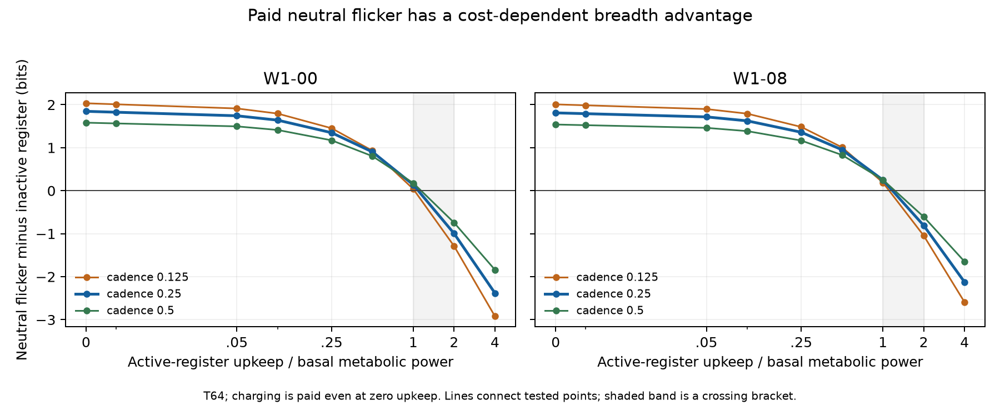

# Paid register variation and blocked behaviour: assessment

The four-arm control completed all 216 registered analyses. All three
predictions passed. At the positive-cost reference, independently activated
register variation beats an inactive register, removing blocked escape drive
improves breadth, and neutral flicker beats the original adverse arm.
That explains the earlier effect more sharply, without erasing its counterexample.

## Reference result

T64, cadence 0.25, upkeep/basal ratio 0.05:

| Comparison | W1-00 | W1-08 |
| --- | ---: | ---: |
| Independent flicker B_R minus inactive register B | +1.742170 | +1.716231 |
| Injury-linked register without response A0 minus blocked-response A | +0.422150 | +0.538689 |
| Independent flicker B_R minus injury-linked/no-response A0 | +1.062082 | +1.024058 |
| Original blocked-response A minus independent flicker B_R | -1.484232 | -1.562747 |
| Original blocked-response A minus inactive B | +0.257938 | +0.153484 |

Units are complete finite-history bits. The final line reproduces the old
comparison exactly. A0 is the arm called B_T in external discussion. It retains
injury-linked activation but the bit no longer shifts the normal action policy.
It is a mechanism control, not an optimized embedded agent deciding to rewire
its physiology at zero cost.

At the primary horizon/cadence, A0 beats A at all eighteen upkeep/parent points,
and B_R beats A0 at all eighteen. A never beats B_R in that primary grid.
Thus the old adverse arm's advantage over B does not establish a special
benefit of obstructed aversive disposition. An independently switching control
does better, and removing the futile response does better.

## A real break-even, with its scope retained

B_R beats B at ratios 0 through 1, and loses at 2 and 4 in both configurations.
Every tested resolved horizon and cadence puts a sign-change bracket between
1 and 2. Those numbers describe **active-register upkeep power divided by basal
metabolic power**, not the world-average expenditure. This is a bracket, not
an exact root or a universal physiological threshold. No extra adaptive points
were run after observing the sweep.

At primary T64, W1-00 gives +0.138332 bits at ratio1, -0.996717 at ratio2 and
-2.381710 at ratio4. W1-08 gives +0.249030, -0.810197 and -2.125476 respectively.
Zero upkeep still pays the positive charging bill.

## What is and is not matched

The independent on/off rates were fitted using no entropy computation, before
new scientific rankings. At the original T64 reference, both signal occupancy
time and total physical register switch count match A to relative error below
5e-14. The switch count includes register reset at death. Rates are then fixed
across upkeep and cadence; no outcome-driven refitting occurred.

| Parent | Independent on / off rates | Matched occupancy time | Matched switches |
| --- | --- | ---: | ---: |
| W1-00 | 0.058715 / 0.361266 | 0.608307 | 0.693824 |
| W1-08 | 0.059503 / 0.378825 | 0.563371 | 0.670299 |

Unit charging and upkeep costs are the same. Integrated upkeep is therefore
also matched at the reference. Total charging differs: B_R spends 0.173456
versus A's 0.190844 energy in W1-00, and 0.167575 versus 0.184347 in W1-08.
The difference is about 9 percent. Injury can charge A even when the store is
exhausted and no live active register remains; independent activation requires
enough energy to keep the register alive. That residual confound is disclosed.

Matching occupancy and switches does not fix the full joint path law, correlations
with injury/energy, or lifespan. Thus B_R's superiority is not attributed purely
to independence with every cost and temporal correlation held identical.
It nevertheless shows that the positive raw breadth effect is available to a
non-response register under declared paid physical dynamics.

## Physical cost remains visible

B_R's positive breadth does not mean it improves survival or access. At the
reference in W1-00, expected living time falls from B's 7.534635 to B_R's 7.169868
and accepted food from 1.584785 to 1.504943. It is lusher in the resolved readout
despite those losses. B_R has no signal-dependent escape drive and cannot open
the blocked route. Calling it pleasant, painful or exploratory is unwarranted.

For W1-00, the registered coordinate order attributes -1.127084 bits to energy
and +2.869254 bits to the signal, with background/location contributions zero to
numerical precision. This is conditional decomposition, not unique causal
attribution of reaction-family entropy. Removing the signal from the readout
changes the question rather than physically removing it.

Independent activation also does not guarantee statistically nontracking
occupancy: B_R's MI with subsequent breadth decline is about 0.00292/0.00272
bits. Energy costs and conditioning on being alive can generate correlations.
B_R is a neutral **no-response physical control**, not a successful clean K2
nontracking-suffering instantiation. No new suffering kill is scored here.

## Resolution and long-run interpretation

At the reference, B_R-B is positive in all 24 resolved parent/cadence/horizon
comparisons and negative in all 24 merged-signal comparisons. A0-A is positive
in all 24 at both grains. A-B_R is negative in all 24 at both grains. For B_R-A0,
all resolved comparisons are positive but the merged comparisons include eight
positive, thirteen negative and three unresolved results. No preferred grain
was selected to make one narrative win.

The stable resolved B_R-B result supports the ordinary paid-variation mechanism
more strongly than the original A-B comparison, which flipped with cadence.
It does not show that matching cancels all cadence effects or determines one
intrinsic possibility ruler. Every valuer ultimately dies; the rates converge
to the common background and the arm differences are finite offsets. This says
nothing against sustained powered flicker in a maintained world.

The original functional A>B counterexamples remain. A better B_R alternative
does not repair the unrestricted pairwise claim that obstructed suffering must
always rank below calm obstruction. Conversely, the results do not establish
that aversiveness itself creates the gain or that real felt valence is represented
by these minimal controllers.

## Next physical boundary

The subsequent [exploration](../exploration/RESULTS.md) batch added costed
movement between resource patches. The [paid-sensing](../paid_sensing/RESULTS.md)
batch then isolated informative from stock-independent writing, and the
[renewal](../renewal/RESULTS.md) batch added ongoing physical operation. These
are separate modules and laws, preserving this batch and its adverse findings.
Its common mortality tail limits these comparisons to offsets, without implying
that maintained variation or information cannot contribute a continuing rate.
The15October interpretation follows the Drive revision posture: local physical
mechanism evidence, not an interpersonal ethical verdict. See the
[cross-run synthesis](../INTERPRETATION_SYNTHESIS_2026-10-15.md).
Distinct effort bills and graded register levels are documented separately in
REGISTER_EXTENSION_ROADMAP.md and require their own freezes.

## Execution

- Physical calibration:2.277s, 88.7MiB; no entropy fit.
- Registered smoke:7.456s, 132.8MiB; scientific comparisons withheld.
- Scientific batch:48.746s, 140.8MiB; no cap hit.
- Maximum numerical residual:9.09e-13.
- 52 focused and neighbouring tests pass; static checks clean.
- Input hash:`c69e16113f3d89b953f8063b31c8a7d701b2c83b0cf96109783eb03d3a83eda5`.

Full surfaces, brackets and readouts are in REGISTER_CONTROL_SUMMARY.json and
REGISTER_CONTROL_PARAMETER_MAP.csv. Raw data and verified snapshots stay in
ignored local results. No large data dump is staged for Git and no push occurred.
