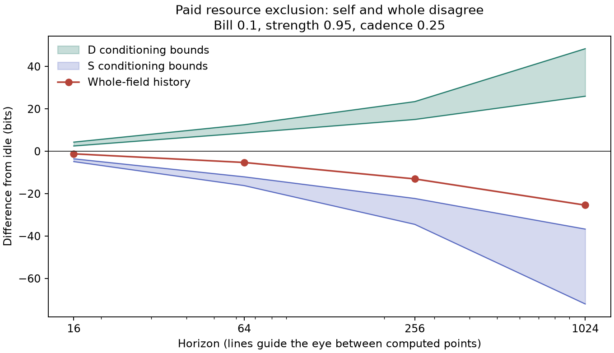

# Completed priority C5 comparison

15 October 2026. The two-case priority companion is complete and verified. The larger 28-case map is still running.

Resource-entry blocking raises D marginal-history lushness while lowering S and the whole field at all four horizons and all three tested cadences. This comparison uses the same fractional bank, source, bath, resource pocket and initial coordinates in both arms. Only the paid intervention differs.

κ=0 removes the extra catalytic complementarity. It does not make the worlds separable: both compartments draw on the same stochastic resource packet.

| Horizon | Whole Δ bits | D difference interval | S difference interval |
| ---: | ---: | ---: | ---: |
| 16 | -1.205 | [2.501, 4.321] | [-4.863, -3.554] |
| 64 | -5.287 | [8.610, 12.524] | [-16.196, -12.065] |
| 256 | -13.040 | [15.011, 23.435] | [-34.469, -22.263] |
| 1024 | -25.406 | [25.969, 48.384] | [-72.023, -36.708] |

The table uses cadence 0.25. CORRIDOR_MAP.csv records the same resolved signs at 0.125 and 0.5. These are hidden-Markov conditioning bounds on the actual subject histories, not bound midpoints or coordinate shares.

## What supplies the private advantage

D gains continuation breadth, but a net energetic profit has not been demonstrated. At T256 it gains 0.081 additional net capture units and spends 0.330 on intervention. The capture-minus-bill margin is −0.248, before a complete subsystem energy balance.

Blocking replaces a targeted S transition with a paid D bank change. At a fixed physical state this redirects an existing event rate. Identical physical destinations, including collisions with the fractional bath, are aggregated before entropy is calculated. No action-label entropy is added. The broader activity controls show why private breadth need not mean useful resource gain.

## Interpretation

The self-versus-whole ranking conflict is now resolved through T1024 in this adapter. Whole-field lushness rejects this restrictive world even though D private-history lushness prefers it. The whole-field stationary-rate difference at cadence 0.25 is also negative (−0.014553 bits/time); that is a consistency diagnostic beside the finite-history result. No D marginal-rate claim is inferred from it.

The material-appropriation question remains for the paid sequestration mechanism. Current subjects are embodied apparatus/controller channels, and active friction is an explicit coarse nonequilibrium boundary. This supports subject-sensitive physical comparisons within that model; it does not by itself establish a general ethical theorem.

Configuration: opportunity yield 1, κ=0, bank capacity 3, quantum 0.1, access-entry blocking strength 0.95, bill 0.1. Full clocks 0.125/0.25/0.5 and horizons 16/64/256/1024. Original numerical source hash `1449c792d18313900d65f17258a0f3afbb518b541554526e27a66b5a65153e98`. Receipts and validation: PRIORITY-COMPANION_STATUS.json and PRIORITY-COMPANION_VALIDATION.json.

## Independent native-field cross-check

Reanalysis of the existing Stage A conservative-field control gives the reverse
subject conflict at T1024: a unit trap potential raises S and whole-field
breadth while lowering D breadth at all three clocks. At cadence 0.25 the whole
gains 83.150 bits, D changes by [−20.361, −2.835], and S by [+86.559, +99.035].
The active field and device formation/loss energy are included in the native
dark detailed-balance check. This is an existing result recovered in the
interpretation, not a new run or an expenditure-matched actuator comparison.
The full table is in [the updated Stage A follow-ups](../domination_stage_a/UPDATED_FOLLOWUPS.md).
