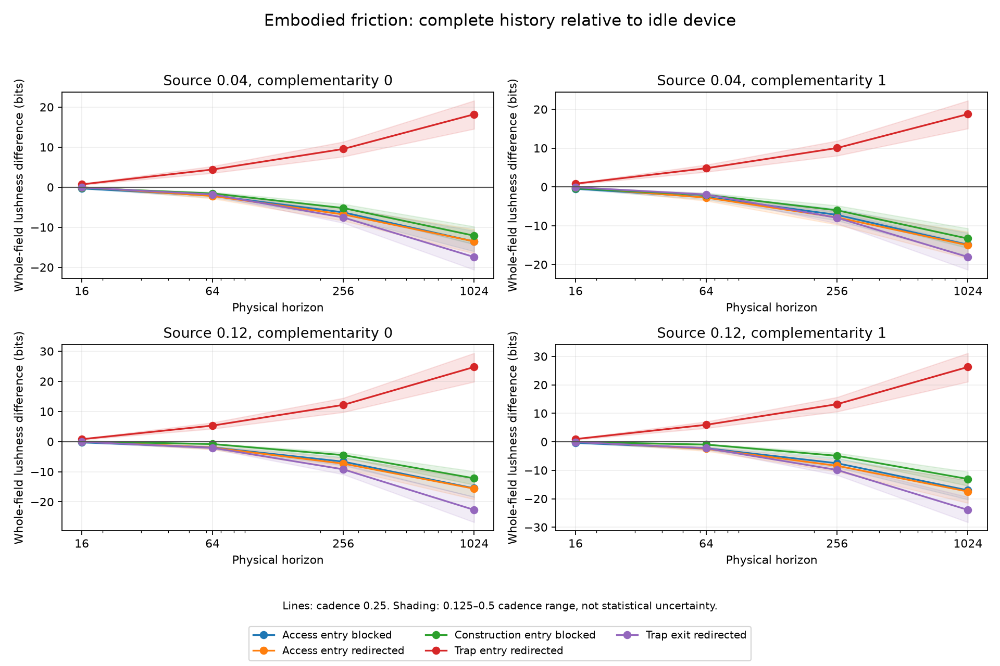

# What the first friction map establishes

**Initial interpretation — 15 October 2026.** First completed 24-case mechanism
map; broader cost/strength and chemical-control comparisons remain subsequent work.

The first slice separates beneficial restriction from access suppression using
physical consequences alone. Whole-field lushness chooses steering away from
the slow-recovery trap in all four resource/complementarity environments, at
all four horizons and all three cadences. From T64 onward, the same intervention
also has strictly greater S marginal-history entropy than idle under the
conditioning bounds. No reward for protection or penalty for control was added.

## The distinction is in the continuation

At T256/cadence0.25, over the four environments:

| Intervention | Whole-field difference from idle | S marginal difference |
| --- | ---: | --- |
| Block entry to resource access | −7.54 to −6.29 bits | Strictly lower |
| Redirect entry to resource access | −8.43 to −6.80 bits | Strictly lower |
| Block entry to construction | −6.03 to −4.49 bits | Strictly lower |
| Redirect entry away from trap | +9.55 to +13.21 bits | Strictly higher |
| Redirect attempted trap exits | −9.89 to −7.55 bits | Strictly lower |

These signs hold at every cadence from T64 onward. Preventing trap entry lowers
mean trap occupancy by 2.39–3.06 percentage points and raises mean access
occupancy by 0.80–1.03 points at T256. S captures more resource and performs more
paid construction. Confinement has the opposite access and construction effects.
Resource-entry restrictions raise D's net capture and reduce S's, while lowering
whole-field breadth. These are measured flows, not signs inferred from labels.

Stocks do not supply the verdict. Trap avoidance lowers mean S apparatus by
0.38–0.61 percentage points while improving its access and breadth. Blocking
construction entry increases mean apparatus by 0.70–0.93 points while lowering
paid construction and breadth: less time in the construction compartment also
reduces reverse construction. The useful object is what the apparatus can
continue doing, not maximum retained stock or maximum gross build count.

Complementarity strengthens the T256 whole-field consequences in this map.
For supply0.12, the benefit of avoiding the trap rises from +12.20 to +13.21 bits
as kappa goes from0 to1; the access-blocking deficit increases from −6.66 to
−7.54 bits. The native shared resource already creates rivalry at kappa0.
This does not establish that D's self-interest has aligned: its subject entropy
is a separate readout.

## What the self perspectives resolve

S's preferred fixed candidate is trap-entry steering at T64/T256/T1024 across
the cadence corridor. D's T256 marginal differences from idle are unresolved
at cadence0.25 for every intervention. Increased D capture is not a proven
increase in D lushness, and chain-rule coordinate shares cannot substitute
for the missing marginal precision. The possible self maximizers remain in
COMPARISONS.json rather than being selected by interval midpoints.

This is the useful boundary for the next subject comparison: tighter D-history
queries and a range of actual intervention costs can distinguish resource gain,
actuation expense and additional D switching. The current run supplies no
claimed selfish-D optimum or full bilateral-control result.

## Short horizons and assumptions remain legible

All four resource-entry steering comparisons flip sign across cadences at T16.
Construction blocking is briefly globally positive at all three cadences in
the supply0.12/kappa1 environment, despite lower S marginal breadth. It is not
the winning whole-field candidate; trap avoidance is better. From T64 onward
construction blocking is negative throughout. These observations map early
cost/activity effects and later enabling consequences rather than failed guesses.

Positive-cost blocking still counts the physical rejected attempt through D's
fuel transition. Steering also counts its physical redirected outcomes. Neither
mode has an automatic whole-world activity subtraction. The temporal activity
and finite terms explain these profiles without subtracting any noise.

The source and bath prescription are matched; accepted work, state occupancy,
event count and realized friction expenditure are not matched. Equal phi and
unit bills therefore do not isolate equal amounts of interference. Roles come
from native physics, but the trap is specifically a low-mobility well in this
adapter. A different trap or a useful confinement mechanism could change the
ordering and should be represented directly.

Active friction is a coarse one-way driven control boundary with explicit D
fuel accounting. Its complete reversible chemical mechanism remains a further
physical module. Native dark chemistry passes detailed balance and the whole
first-law ledger closes; neither result alone proves a microscopic controller
thermodynamics. There is no excision action, suffering variable, S revolt,
controller uncertainty, permanent closure or open-ended population in this slice.

## Engineering and next expansion

All24 cases completed in 552.44 seconds of summed worker time, peak364.76 MiB,
under120s/512MiB/32MiB per-case caps and a900-second batch budget. Each full
world has2304 states. All three cadences and all four horizons were retained.
The32 focused adapter/composition checks pass. Maximum generator energy residual
is4.44e-15, integrated energy residual4.97e-13, sampled-occupation residual
4.40e-12; both coordinate orders sum to global entropy to the reported precision.
Compact case JSON, including the smoke, occupies about1.58MiB. No large kernel
is retained or published.

The module now supports expanding cost, strength and physical target sets,
followed by a choosing-D experiment with subject rankings resolved where
possible. A chemical/energy-shift realization can check dependence on the
current intervention mechanism. Revolt and correction then add S's own physical
responses. The architecture keeps these as native extensions and readouts.

[Full results](RESULTS.md) · [Model](MODEL.md) · [Comparison map](COMPARISONS.json)
