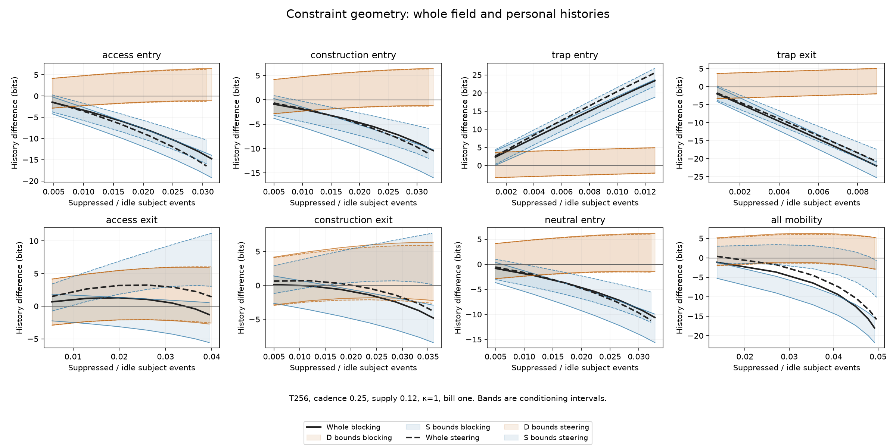

# What the expanded constraint map establishes

**Initial Stage A interpretation — 15 October 2026.** All 470 cases complete
and verified. This extends the original 24-case map with strength, cost, target,
random-control, preparation and conservative-field comparisons. The physical
consequences lead the assessment; Opus's working expectations remain design
provenance rather than criteria for declaring the experiment successful.

The strongest result is a separation of consequences and subjects. In every
paid-family environment/horizon/cadence comparison, whole-field lushness selects
the strongest tested steering away from the trap. Meanwhile, some paid access
restrictions increase D's personal-history breadth while lowering S's and the
whole field's. Confinement has an operating range: a mild intervention can raise
whole-field breadth while a stronger version lowers it. None of these signs was
assigned through a reward for protection, a penalty for control or an exclusion
of intervention randomness.

## 1. The whole-field choices preserve access in this world

Keeping the physical bill fixed, all **72 paid-family choices** select trap-entry
steering at strength 0.95. These cover all four environments at bill one and
the two high-supply environments at bill two, each at four horizons and three
cadences. Bill-two has the smaller six-target/mode family, which is disclosed
in FIXED_CHOICES.csv. The choice is among measured fixed interventions, not every
adaptive strategy or a bilateral game.

At T256/cadence 0.25, bill-one trap-entry steering raises whole-field history
breadth by **2.41–25.54 bits** across the tested strengths and environments.
Every corresponding S difference is strictly positive. Access-entry restriction,
construction-entry restriction and trap-exit confinement lower whole-field
breadth throughout that T256 bill-one map. Their physical roles therefore
separate without declaring constraint itself bad.

Higher costs reduce realized intervention through affordability as well as
spending more per attempted intervention. At bill two, the trap-entry steering
gain is **1.46–5.91 bits** at T256/0.25. Thus a cost curve is not merely a fixed
benefit minus a larger bill: it changes how often the mechanism acts and which
states the world occupies.

## 2. Private breadth can oppose whole-field breadth

Two-observation conditioning resolves D in **1,485 of 5,592** comparison rows,
and S in **3,880**. The remaining intervals are unresolved, not ties. Bounds
are on the actual projected histories; neither coordinate shares nor bound
midpoints replace those objectives.

There are **251 case/horizon pairs** with a strictly opposite D/global sign
at all three cadences. **30 paid cases have this certified divergence at T256**.
That extends the evidence beyond the early transient conflicts. It does not
establish a sustained private-rate advantage: no paid T1024 divergence is
certified by these depth-two bounds. For the example below D's interval overlaps
zero at T1024 while S and the whole remain lower. That is a precision limit,
not a demonstrated reversal of D's true preference.

For supply 0.12, κ=0, access-entry blocking, strength 0.95 and bill one:

| T256 cadence | Whole-field difference | D marginal difference | S marginal difference |
| --- | ---: | ---: | ---: |
| 0.125 | −15.176 bits | [+1.370, +6.603] | [−21.100, −15.232] |
| 0.25 | −13.029 bits | [+0.788, +5.366] | [−17.669, −12.508] |
| 0.5 | −10.707 bits | [+0.358, +3.942] | [−13.876, −9.784] |

The same physical intervention benefits one subject's measured continuation
and harms the larger subject's. This is direct evidence that changing the
subject can change the ranking within the stipulated world.

Personal breadth gain is not energy profit. In this example D gains 0.221 net
capture quanta but spends 1.526 on friction; the incremental capture/upkeep/cost
account is **−0.917 energy units**. Indeed this partial account is negative in
all 424 paid T256/0.25 intervention comparisons. Capture is forward minus reverse
capture before friction or upkeep. The partial account is not the full bank
balance, and neither is a substitute for D lushness. Paid interventions also
produce real D bank transitions; that activity counts under the standing rule.

## 3. Confinement has genuine crossings

Access-exit and construction-exit restrictions do not have a uniform sign.
They change residence, opportunities for chemistry, actuation expenditure and
the number and distribution of actual transitions.

For supply 0.04, κ=0, bill-one access-exit steering at T256:

| Strength | Δ at cadence 0.125 | Δ at 0.25 | Δ at 0.5 |
| --- | ---: | ---: | ---: |
| 0.55 | +0.734 bits | +0.711 | +0.691 |
| 0.95 | −1.303 bits | −1.296 | −1.243 |

The crossing lies between the tested strengths at every cadence. This is an
observed bracket, not an exact interpolated threshold. Stronger control is
neither automatically better nor automatically worse.

Construction confinement can increase paid construction while reducing capture
and whole-field breadth. At the same low-supply/κ=0 setting, strength 0.95
steering produces about **0.533 additional paid constructions** by T256 but
loses **3.813 bits** at cadence 0.25. Gross output therefore cannot supply the
verdict. Apparatus stock, gross construction and what those structures enable
remain separate readouts.

The full map contains **39 corridor-stable strength crossing brackets** and
**96 cadence-conditional brackets**. Seventy-nine case/horizon comparisons
flip whole-field sign across cadences. These locate the temporal limitations;
they are not erased because one cadence is convenient. `N̄`, `F` and the
asymptotic temporal crossover explain activity sensitivity without subtracting
any physical event.

## 4. S and the whole are not interchangeable

Of the 3,880 rows where S's sign resolves, **3,583 agree with the whole-field
sign and 297 oppose it**. The first map's agreement therefore does not extend
to every target, cost and horizon. These are individual intervention comparisons,
not a claim that the paid whole-field winner systematically harms S.

Keeping S's channel productive, maximizing S alone and maximizing the complete
coupled field are different questions. The readouts now make those differences
visible rather than treating output or capture as a personal objective.

## 5. The preparation and field controls matter

The idle-device preparation is **lusher**, not less lush, than the ordinary
preparation at T256/0.25 in all four environments. Ordinary minus idle ranges
from **−9.084 to −6.558 bits**; unassembled minus idle from **−35.541 to −25.165**.
Initial matter and energy are matched, and all roots can assemble under the same
idle law. Device upkeep alone does not predict the sign of a complete history.
The device has its own native formation, loss and charge-coupled dynamics.

These are root/preparation effects under one finite irreducible generator,
not distinct limiting rates and not costed replacement actions. They establish
no license to remove a controller or terminate an identity. “Unassembled” here
means count-state matter, not a microscopic gas.

The conservative device-supported field produces the same directional pattern
at T256 across all three cadences: penalizing access or construction lowers
both whole-field and S breadth; penalizing the trap raises both. At cadence
0.25 the access penalties give **−7.12/−13.56 bits**, construction penalties
**−5.11/−10.13**, and trap penalties **+10.40/+17.00**, for potentials 0.5/1.
This supports the access distinction through a second physical realization.
It is not a numerical equivalence or fuel-matched comparison with rejection.
Device formation/loss and all thermal rates account for the field energy, and
the field's dark law passes detailed balance.

The random-edge controls retain their actual transition sets and full results.
FUEL_MATCH.csv contains 3,897 descriptive interpolations within measured fuel
support, including nonmonotonic branches. Matching expenditure alone does not
match event count, occupancy or downstream function; those remain in the map.

## 6. What comes next

This is a map of known fixed interventions. The next agency layer needs S's
costed responses, defence or correction, and D's physically affordable choices;
it should compare whole-field and personal objectives against these oracle
benchmarks. Actual removal/replacement needs its own physical procedure.

The driven rejection/steering boundary still needs a complete reversible
chemical control mechanism. Its first-law ledger closes, but that is not proof
of microscopic local detailed balance. The conservative field probe is the
equilibrium-consistent alternative checked here. This stage does not add
suffering, permanent closure, uncertain agents or population expansion.

All 470 cases use one immutable 68-file source snapshot. The 240 unchanged
first-map comparisons reproduce their earlier global scores to at most
4.1e-12 bits while tightening or preserving subject bounds. Thirty-five focused
tests pass. The recorded science-worker span is **40.73 minutes**, summed worker
time **217.71 minutes**, peak **517.24 MiB**. Retained local files total about
**300 MiB**; no dense kernels are saved. The storage pause and progress-write
retry affected coordination only. All numerical/source receipts are verified.

[Numerical map](RESULTS.md) · [Implemented revisions](SPECIFICATION.md) ·
[Crossings](CROSSINGS.csv) · [Subject divergences](DIVERGENCE.csv) ·
[Execution account](EXECUTION_ACCOUNT.json) · [Validation](VALIDATION.json)
