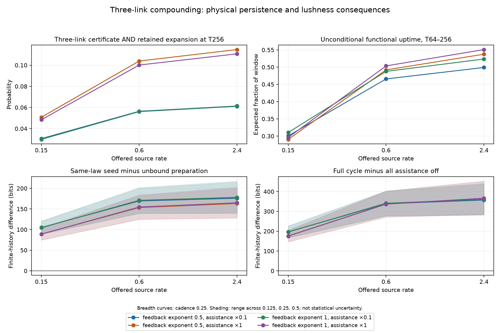

# Three-link compounding: mechanism, persistence and lushness

**Updated interpretation — 15 October 2026.** This current assessment replaces
the earlier combined-checklist verdict. Physical outputs are unchanged.

This run demonstrates paid three-step enabling with retained expansion, and
regimes where that compounding persists and increases finite-history lushness.
The cycle is physical: A assists construction of B, B assists C, and C assists
A; apparatus also enables resource capture that helps pay for further activity.
The lineage monitor reads the resulting histories without adding entropy.

## What the run demonstrates

- All 12 of 12 shape settings have a conservative probability above 1%
  of three successive enabling links with retained expansion at T256, including
  square-root feedback. The probabilities are reported continuously below.
- 4 distinct shape regimes combine this mechanism with expected functional
  uptime above one half over T64–256 and positive lushness consequences.
- At T256, the full mechanism beats the unbound preparation in 40/40
  settings, all assistance off in 40/40, and the C-to-A cut in
  40/40. Each positive comparison holds across cadences 0.125, 0.25
  and 0.5, with the numerical error allowance included.
- Individual construction-link ablations reduce unlabelled retained expansion
  in the shape grid. The physical benefit therefore extends beyond the named
  lineage detector itself.

For linear feedback, full assistance and source rate 2.4:

| Physical readout | Result |
| --- | ---: |
| Three-link completion by T256 | 16.24% |
| Completion and retained expansion at T256 | 11.08% |
| Depth by 64, function at 64, expansion at 256, no closure, on the same histories | 9.92% |
| Expected functional uptime over T64–256 | 55.10% |
| T256 seed minus unbound, cadence 0.25 | +164.95 bits |
| T256 full minus all assistance off | +366.27 bits |
| T256 full minus C-to-A cut | +152.25 bits |

These are three successive enabling links, with compounding and later function
connected on the same paths. The monitor is conservative and can miss genuine
chains. The demonstration is finite-depth and confined to this count adapter.

## Energy funding and the reporting correction

Construction and maintenance pay native energy bills. Initial stored resources
are part of the physical present; using them is legitimate. As the continuation
develops, external capture supplies an increasing conservative share of spending:

| Horizon, linear/full-assistance/source 2.4 | External-spending lower bound |
| --- | ---: |
| 256 | 75.39% |
| 1024 | 87.70% |
| 4096 | 92.67% |

The old combined checklist required this lower bound to exceed 80% at T256.
That guessed cutoff made every combined J flag zero. It did not establish
absence of funding or failure of the physical principle. Its use as the headline
verdict was an interpretation error. Funding, recovery and persistence are
physical profiles to understand, not arbitrary gates defining generativity.

The original plans and numerical checklist remain available as provenance.
Their missed operational guesses are not the scientific conclusion, and no
physical outcome or lushness score has been changed to obtain this assessment.

## What determines the operating range

Stronger damage reduces retention and functional uptime. For linear feedback
and source 0.6, damage rates 0.005, 0.02 and 0.08 give uptime fractions 0.5036,
0.1128 and 0.0010; three-link-plus-retained probabilities fall from 0.10015 to
0.00884 and 0.00000784. Compounding still occurs under damage, while its products
are retained for less time. The recovery profiles map that limitation directly.

Across the stress groups, functional persistence and the measured breadth gains
are positively associated, with Spearman correlations 0.821–1.0. This supports
the persistence relationship in this model; an opportunity-window experiment
would be needed to test a specific repayment prediction.

The seed beats the thermal reference in 0/40 settings. That reference
already contains mean apparatus 4.2577 and an initial complete loop with
probability 47.17%, versus one apparatus in the seed. It is an equienergy
count-state preparation, not a spatial gas. This ordering remains part of the
result. The present adapter has no translational motion and does not settle
the earlier spatial lattice comparison.

A further irreversibility comparison finds four of eight cases where greater
permanent damage increases T256 breadth across all cadences while lowering
functional uptime. One example gains 1.168 bits at T256 and loses 2.460 bits
at T4096. This real horizon dependence remains in the assessment. It concerns
different physical laws, rather than an agent choosing damage.

Finite-history lushness is primary. Same-law roots share the limiting rate;
mechanism contrasts can change it. Rates and temporal activity decompositions
explain ongoing contribution without replacing the finite continuation. The
source and bath are matched here; accepted work and event activity are not.

## Complete continuous setting map

Differences below are at T256 and cadence 0.25. Positive signs for the three
displayed contrasts also hold at the other two cadences. Four R0 rows reuse
shape cases; the 40 rows are not 40 independent full-mechanism simulations.

| Setting | Three links + retained | Functional uptime 64–256 | Closure by 256 | External funding lower bound | Δ unbound bits | Δ all-off bits | Δ C-to-A cut bits |
| --- | ---: | ---: | ---: | ---: | ---: | ---: | ---: |
| A-a0.5-k0.1-s0.15 | 0.030521 | 0.3006 | 0.0000 | 0.608 | +105.08 | +197.08 | +37.22 |
| A-a0.5-k0.1-s0.6 | 0.056412 | 0.4658 | 0.0000 | 0.697 | +169.43 | +338.79 | +89.15 |
| A-a0.5-k0.1-s2.4 | 0.061387 | 0.4991 | 0.0000 | 0.732 | +176.00 | +357.50 | +98.61 |
| A-a0.5-k1-s0.15 | 0.050738 | 0.2905 | 0.0000 | 0.630 | +89.10 | +176.32 | +53.12 |
| A-a0.5-k1-s0.6 | 0.103939 | 0.4920 | 0.0000 | 0.720 | +153.37 | +337.00 | +134.70 |
| A-a0.5-k1-s2.4 | 0.114791 | 0.5376 | 0.0000 | 0.754 | +163.17 | +366.21 | +150.50 |
| A-a1-k0.1-s0.15 | 0.029800 | 0.3104 | 0.0000 | 0.614 | +104.48 | +196.11 | +38.26 |
| A-a1-k0.1-s0.6 | 0.056080 | 0.4877 | 0.0000 | 0.704 | +170.88 | +341.18 | +93.78 |
| A-a1-k0.1-s2.4 | 0.061097 | 0.5236 | 0.0000 | 0.737 | +178.11 | +361.03 | +104.00 |
| A-a1-k1-s0.15 | 0.048341 | 0.2959 | 0.0000 | 0.629 | +89.00 | +175.20 | +53.01 |
| A-a1-k1-s0.6 | 0.100146 | 0.5036 | 0.0000 | 0.720 | +154.63 | +336.67 | +136.07 |
| A-a1-k1-s2.4 | 0.110756 | 0.5510 | 0.0000 | 0.754 | +164.95 | +366.27 | +152.25 |
| B-a0.5-s0.15-R0 | 0.050738 | 0.2905 | 0.0000 | 0.630 | +89.10 | +176.32 | +53.12 |
| B-a0.5-s0.15-R1 | 0.001064 | 0.0371 | 0.0000 | 0.425 | +34.42 | +71.07 | +14.71 |
| B-a0.5-s0.15-R2 | 0.000001 | 0.0004 | 0.0000 | 0.000 | +6.66 | +13.87 | +0.48 |
| B-a0.5-s0.15-R3 | 0.001034 | 0.0370 | 0.0002 | 0.422 | +34.84 | +71.72 | +14.77 |
| B-a0.5-s0.15-R4 | 0.001075 | 0.0311 | 0.0000 | 0.427 | +33.01 | +68.30 | +14.82 |
| B-a0.5-s0.15-R5 | 0.001047 | 0.0310 | 0.0002 | 0.425 | +33.41 | +68.92 | +14.89 |
| B-a0.5-s0.15-R6 | 0.000471 | 0.0341 | 0.0348 | 0.406 | +35.15 | +72.04 | +13.98 |
| B-a0.5-s0.6-R0 | 0.103939 | 0.4920 | 0.0000 | 0.720 | +153.37 | +337.00 | +134.70 |
| B-a0.5-s0.6-R1 | 0.009314 | 0.1101 | 0.0000 | 0.648 | +67.17 | +162.90 | +71.48 |
| B-a0.5-s0.6-R2 | 0.000008 | 0.0010 | 0.0000 | 0.074 | +9.38 | +24.31 | +2.37 |
| B-a0.5-s0.6-R3 | 0.007678 | 0.1050 | 0.0011 | 0.637 | +65.77 | +159.71 | +67.55 |
| B-a0.5-s0.6-R4 | 0.009609 | 0.1053 | 0.0000 | 0.655 | +67.28 | +162.81 | +74.28 |
| B-a0.5-s0.6-R5 | 0.007950 | 0.1000 | 0.0010 | 0.644 | +65.92 | +159.70 | +70.46 |
| B-a0.5-s0.6-R6 | 0.001576 | 0.0770 | 0.1073 | 0.588 | +58.72 | +143.61 | +51.10 |
| B-a1-s0.15-R0 | 0.048341 | 0.2959 | 0.0000 | 0.629 | +89.00 | +175.20 | +53.01 |
| B-a1-s0.15-R1 | 0.001004 | 0.0377 | 0.0000 | 0.424 | +34.25 | +70.41 | +14.35 |
| B-a1-s0.15-R2 | 0.000001 | 0.0004 | 0.0000 | 0.000 | +6.64 | +13.83 | +0.47 |
| B-a1-s0.15-R3 | 0.000984 | 0.0377 | 0.0002 | 0.421 | +34.68 | +71.10 | +14.43 |
| B-a1-s0.15-R4 | 0.001011 | 0.0316 | 0.0000 | 0.426 | +32.85 | +67.62 | +14.38 |
| B-a1-s0.15-R5 | 0.000992 | 0.0316 | 0.0002 | 0.424 | +33.26 | +68.26 | +14.49 |
| B-a1-s0.15-R6 | 0.000462 | 0.0348 | 0.0346 | 0.406 | +35.04 | +71.55 | +13.76 |
| B-a1-s0.6-R0 | 0.100146 | 0.5036 | 0.0000 | 0.720 | +154.63 | +336.67 | +136.07 |
| B-a1-s0.6-R1 | 0.008839 | 0.1128 | 0.0000 | 0.648 | +67.34 | +161.42 | +70.57 |
| B-a1-s0.6-R2 | 0.000008 | 0.0010 | 0.0000 | 0.074 | +9.35 | +24.20 | +2.32 |
| B-a1-s0.6-R3 | 0.007352 | 0.1078 | 0.0011 | 0.637 | +66.01 | +158.47 | +66.87 |
| B-a1-s0.6-R4 | 0.009050 | 0.1079 | 0.0000 | 0.655 | +67.40 | +161.02 | +73.00 |
| B-a1-s0.6-R5 | 0.007560 | 0.1028 | 0.0010 | 0.645 | +66.13 | +158.21 | +69.47 |
| B-a1-s0.6-R6 | 0.001542 | 0.0791 | 0.1081 | 0.588 | +59.01 | +142.92 | +50.93 |

## Reproduction and scope

All 144 cases completed in 32.9 minutes of summed worker
time, with maximum process-tree memory 352.9 MiB.
Thirty-six focused tests passed. Energy residuals are at most 1.23e-11 and
monitor projection errors at most 4.44e-16. Physical randomness is fully counted.

The evidence establishes the intended finite three-link mechanism and a
persistent, lushness-positive operating region. Spatial gas competition,
open-ended expansion, network superiority and ethical behavior are further
questions, each requiring its own physical model.

Current report generator: `scripts/report_robust_generativity_assessment.py`.
The original reporting generator reproduces the historical checklist only.

[Structural interpretation](INTERPRETATION.md) · [Original protocol](PROTOCOL.json) ·
[Numerical summaries and original checklist](SUMMARY.json) ·
[Machine-readable map](SETTING_MAP.csv) · [Further diagnostics](EXPLORATORY_DIAGNOSTICS.json)
