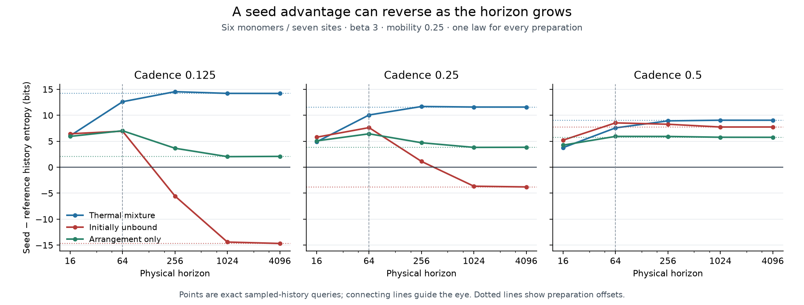

# Horizon sufficiency audit

**Updated interpretation — 15 October 2026.** Includes the complete 14-law
cadence-sign audit and distinguishes transient spatial organization from the
separately demonstrated persistent compounding mechanism. Numerical results
and original forecasts remain available as provenance.

Retrospective follow-up prompted by the user's horizon question. The original protocol, finite-history scores and prediction outcomes remain unchanged. Every original law is extended under the same frozen physical source; no winning subset is selected.

## Objective and rate

Complete conditional finite-history lushness remains primary. Rate is a diagnostic of sustained contribution under maintained boundaries. All preparation roots in one finite irreducible Q have a common rate. The horizon audit therefore compares actual finite-history differences with their preparation offsets, rather than using a rate to replace those scores.

For sampled Poisson vectorb, the seed-minus-reference tail is -(mu_seed-mu_reference) exp(QT)b. Its absolute value is at most the oscillation max(exp(QT)b)-min(exp(QT)b). This Markov bound covers every pair of roots or root mixtures. The accumulated sampled-Poisson residual bound2*(T/delta)*||residual||_infinity is reported separately. These are validated numerical calculations, not interval-arithmetic certificates.

AtT1024 the largest global tail oscillation was3.70742bits. The extended queries ended at[4096]; all laws satisfied the filed1e-3bit tail-plus-Poisson-error criterion: **True**. Largest final oscillation0.000131367bits; largest accumulated pair-error bound7.53288e-06bits. This supports asymptotic interpretation to that diagnostic tolerance, not a unique ethical horizon.

## Final signs

| Reference | Positive at cadence0.25 | Negative at cadence0.25 | Positive at all three cadences |
| --- | ---: | ---: | ---: |
| thermal | 12 | 2 | 12 |
| unbound | 0 | 14 | 0 |
| arrangement | 3 | 11 | 3 |

### Cadence signs against the unbound preparation

The complete map answers the later ledger-review question directly:

| Physical horizon | Laws changing sign across cadences | Negative at all three | Positive at all three |
| ---: | ---: | ---: | ---: |
| 16 | 3 | 8 | 3 |
| 64 | 3 | 9 | 2 |
| 256 | 2 | 12 | 0 |
| 1024 | 2 | 12 | 0 |
| 4096 | 2 | 12 | 0 |

The two late-horizon flips are the native-assistance, mobility0.25 laws at
beta1.5 and beta3. At T4096 their differences, ordered by cadence0.125/0.25/0.5,
are respectively −18.791683/−9.285306/+0.573782 bits and
−14.674469/−3.792175/+7.743736 bits. The other12 laws favour the unbound
preparation throughout that temporal corridor. The smallest magnitude among
these late-horizon differences is much larger than the reported numerical error.

Consequently, cadence dependence does not explain away all spatial losses.
The physical model contains paid catalytic feedback, but it does not sustain
the seed's initial assembly advantage. The charge/transport bottleneck and
movement cost described in [model limits](MODEL_LIMITS_AND_NEXT_SLICE.md) make
this a test of transient organization in that regime. These observations map
the persistence limitation; they do not refute the separately demonstrated
compounding mechanism. The records establish the limitation, while isolating
the contribution of each bottleneck would require a mechanism contrast.

This table is a direct regrouping of COMPARISON_MAP.csv and
HORIZON_EXTENSION_MAP.csv, using a1e-5-bit zero tolerance. It changes no
physical outputs or prior comparisons.

## Positive-target case

N6/L7, beta3, mobility0.25, native assistance. AtT64/cadence0.25 the seed leads the unbound reference by7.62767bits. AtT1024 it trails by3.65497bits. The extended scores below retain the reversal and show its temporal-resolution dependence.

| Reference | Cadence | Last horizon | Actual finite-history difference | Offset |
| --- | ---: | ---: | ---: | ---: |
| thermal | 0.25 | 4096 | +11.579639 | +11.579639 |
| unbound | 0.25 | 4096 | -3.792175 | -3.792174 |
| arrangement | 0.25 | 4096 | +3.840536 | +3.840536 |
| thermal | 0.125 | 4096 | +14.204051 | +14.204051 |
| unbound | 0.125 | 4096 | -14.674469 | -14.674469 |
| arrangement | 0.125 | 4096 | +2.088886 | +2.088886 |
| thermal | 0.5 | 4096 | +9.050701 | +9.050701 |
| unbound | 0.5 | 4096 | +7.743736 | +7.743736 |
| arrangement | 0.5 | 4096 | +5.760055 | +5.760055 |

The observed preparation advantage over the full thermal mixture is distinct from robust advantage over an initially unbound gas-like preparation. Some thermal-mixture wins occur without catalytic assistance; the reference's greater initial assembly content and transient motion contribute. The original positive thermal-target prediction passed, but cannot be broadened into an unconditional generativity-against-gas claim.

The useful physical opportunity may end before or after a crossover. Those finite windows need explicit source-lifetime experiments. Infinite maintained drive and a numerically converged offset are diagnostics of this toy, not a replacement for the actual physical continuation or a universal moral ordering.

Tail audit cost355.6seconds including the retained writer-failure attempt. All cases used120s/512MiB caps. Failed receipt and serialization repair are documented in EXECUTION_INCIDENTS.md.
